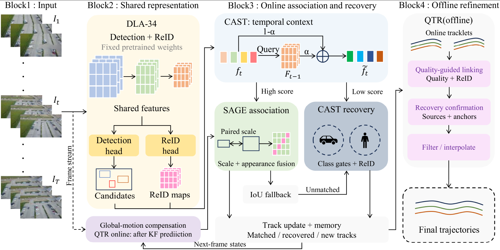

# MQTrack: Scale-Aware Association and Quality-Guided Tracklet Refinement for UAV Multi-Class Multi-Object Tracking

  Yu Chen, Chen Zhang (Student Member, IEEE), Zhongliang Deng (Fellow, IEEE), 
  Zhaoyu Liu, Xinling Wen, Yuxin Qin, Shuai Huo

  School of Electronics and Information, 
  Zhengzhou University of Aeronautics, Zhengzhou 450046, China

The paper has not yet been published; please stay tuned</em>.

## Overview

Multi-class multi-object tracking (MCMOT) in UAV videos requires reliable identity decisions under severe scale variation, uncertain observations, and fragmented trajectories. These challenges affect tracking evidence differently across frame-level association, short-term recovery, and tracklet-level refinement, while errors introduced at earlier stages can influence subsequent decisions. To address these interrelated challenges, we propose MQTrack, a stage-aware tracking framework that coordinates scale-conditioned association, reliability-constrained recovery, and quality-guided tracklet refinement. Specifically, Scale-Aware Guided Embedding Association (SAGE) adapts geometric and appearance matching using a shared pair-specific scale. Category-Aware Spatio-Temporal Recovery (CAST) incorporates temporal appearance context and recent-track reliability to recover uncertain observations while preserving recoverysource information. Quality-Guided Tracklet Refinement (QTR) leverages accumulated tracklet quality to regulate offline linking, retention, and interpolation, with optional validation of recoverysupported segments. On VisDrone2019-MOT test-dev under the five-class protocol, MQTrack achieves 44.4% MOTA and 61.5% IDF1, outperforming its corresponding ablation baseline by 3.8 and 10.6 percentage points, respectively. It further achieves 54.6% MOTA and 72.3% IDF1 on UAVDT test, and 35.8% MOTA and 56.5% IDF1 on VT-MOT-UAV test using RGB observations only. Comprehensive ablation studies across three benchmarks demonstrate the complementary contributions of the proposed components.

## Framework

  

<em>Overall architecture of MQTrack.</em>

